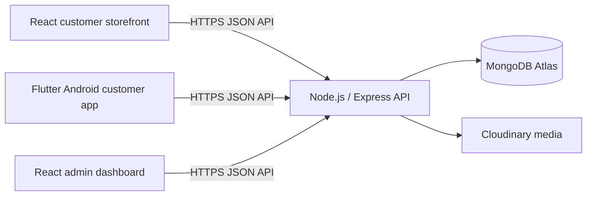

# YoMart architecture

## Components

The API owns customer/admin authentication, catalog records, store configuration, prices, inventory, order state, payment-proof authorization, and customer ownership checks. Frontends render API data and submit intent; browser data is never authoritative for stock or price.

### Services

- **API:** Express app, Mongoose models, JWT bearer authentication, role/ownership middleware, upload and response serialization controls. Health route: `GET /health`.
- **Customer web:** independent React/Vite SPA in `yomart-web`; the Flutter app remains a distinct Android client. Both use the same API contracts.
- **Admin:** independent React/Vite dashboard. Hiding a menu item is only UX; every protected operation must remain authorized on the server.
- **Database:** MongoDB replica set required for multi-document transactions used by order/inventory/idempotency/payment-evidence flows.
- **Media:** Cloudinary or configured local storage for catalog media; authenticated Cloudinary or a private filesystem adapter for payment evidence. Render Free local filesystem is ephemeral, so it is not durable proof storage.

## API boundaries used by the React storefront

The published storefront README and API implementation identify these routes:

| Use | Routes |
|---|---|
| Public catalog | `GET /products`, `GET /products/:id`, `GET /categories`, `GET /brands`, `GET /collections`, `GET /posters`, `GET /retailer-contacts` |
| Search/filter | `GET /products?search=...&category=...&inStock=true|false`; current API has no pagination, public brand filter, or collection-specific filter. |
| Customer identity | `POST /users/register`, `POST /users/login`, `GET /users/profile` |
| Checkout settings | `GET /store-settings/checkout`; public read projection, not an admin settings mutation. |
| Proof upload | `POST /payment/upload-proof-base64`; authenticated; returns a proof record identifier, not a provider URL. |
| Orders | `POST /orders` with `Idempotency-Key`; `GET /orders`, `GET /orders/:id`. |

Order creation recalculates prices and checks stock on the server, uses a transaction, and is protected with customer-scoped idempotency. The React cart stores product IDs and quantities locally; its displayed amount is an estimate until the server confirms the order.

## Known capability boundaries

- There is no server-side cart, refresh-token flow, password recovery, email verification service, payment gateway, collection-specific browsing endpoint, or public product pagination in the current storefront contract.
- Product options/variants lack authoritative option-level price and stock. Both customer clients block products with configured variants from online purchase.
- YoMart fulfillment is destination-based collection: phone and destination city are required, area/landmark is optional, there is no customer delivery fee, and a collection point is shown only after staff records one.
- React client-side SEO is not equivalent to crawlable per-product server-rendered HTML. The separate Flutter SEO generator has not been run against live catalog data and is not part of the React storefront build.
